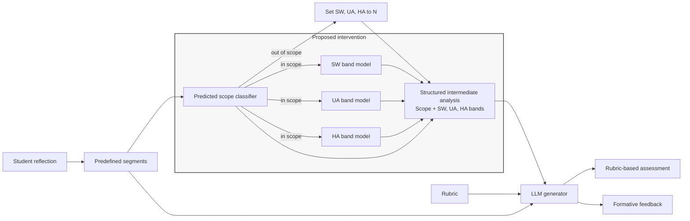
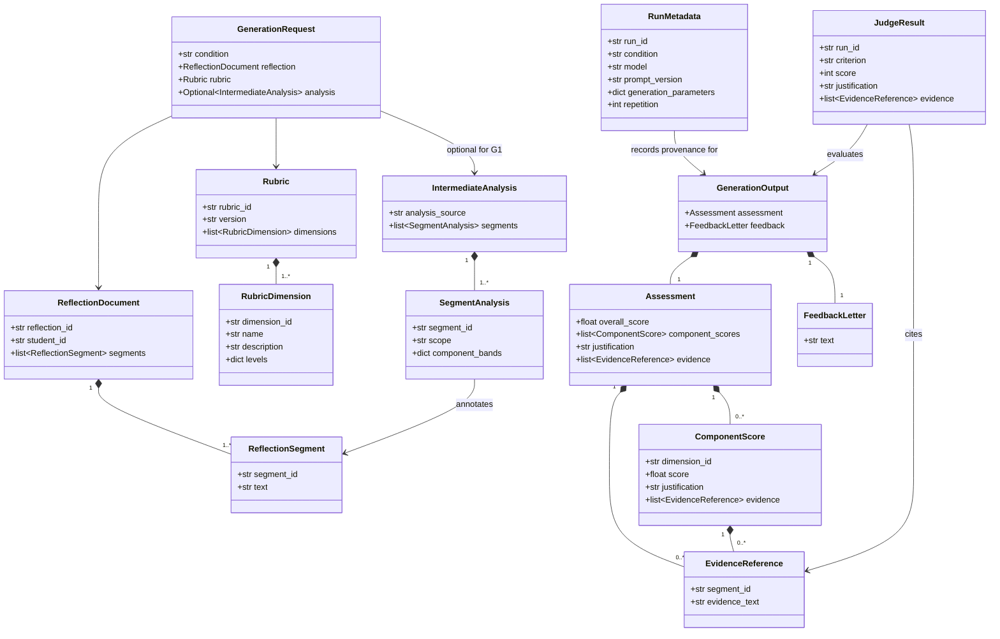

# Structured Intermediate Analysis for LLM-Based Assessment and Feedback

In this experiment, we investigate whether an LLM produces higher quality assessment and feedback, when given structured analysis of a learner's reflection.

The intervention is **analysis-mediated generation**: for each predefined segment, the system first outputs scope-decision; in-scope segments receive component-specific bands for 3 reflection dimensions, namely SW/Perception, UA/Analysis, and HA/Alternatives. Both reflection dimensions and performance band analysis are then supplied to the generator as a structured intermediate representation.

**Status:** 

- Segment-classification notebooks and an R1 development batch for G1/G2/G3 are available.
- Full test-set prediction, adjudicated G3 analysis, and confirmatory evaluation remain in progress.

## Human Rating UI

The standalone browser app lives in [rating-ui/](rating-ui/) as a Git submodule of
the public [prebi-rating-ui repository](https://github.com/nguyenhongquy/prebi-rating-ui).
This research repository pins an exact UI commit. The app opens to expert
onboarding and does not require the other repository's workbench, a Python API,
or a model provider. Node.js 22.12 or newer is required.

Clone this repository with `git clone --recurse-submodules`, or initialize the
submodule in an existing clone before installing dependencies:

```bash
git submodule update --init --recursive
npm --prefix rating-ui ci
npm --prefix rating-ui run dev
```

1. Open the localhost URL printed by Vite (normally `http://127.0.0.1:5174`).
2. Upload only blinded packet JSON, never the protected condition key.
3. Drafts and submitted ratings stay in browser-local storage; download results for protected collection.
4. See [rating-ui/README.md](rating-ui/README.md) for build and data-handling details.

For UI development, work inside the submodule on a branch (for example,
`git -C rating-ui switch main`), then commit and push UI changes to its public
repository. Record the new UI revision in this research repository with
`git add rating-ui` and a parent-repository commit. After pulling research
repository updates, run `git submodule update --init --recursive` to check out
the pinned UI revision. Pushing UI commits to its `main` branch triggers GitHub
Pages deployment independently of this private repository.

Research packets, condition keys, credentials, and rating exports must remain
outside the public submodule. Use this submodule as the authoritative UI working
copy rather than maintaining a second independent copy.

## Running the Notebooks

| Order | Notebook                                                                      | Purpose                                                  |
| ----- | ----------------------------------------------------------------------------- | -------------------------------------------------------- |
| 00    | [00_segment_classification_ml.ipynb](00_segment_classification_ml.ipynb)       | Classical machine-learning segment classification        |
| 01    | [01_segment_classification.ipynb](01_segment_classification.ipynb)             | GBERT segment classification                             |
| 02    | [02_segment_inference.ipynb](02_segment_inference.ipynb)                       | Saved-model segment inference                            |
| 03    | [03_generate_g1_g3.ipynb](03_generate_g1_g3.ipynb)                             | Paired G1/G3 generation                                  |
| 04    | [04_generate_g2.ipynb](04_generate_g2.ipynb)                                   | G2 generation matched to predictions and G1/G3 artifacts |
| 05    | [05_segment_evaluation.ipynb](05_segment_evaluation.ipynb)                     | Segment evaluation                                       |
| 06    | [06_feedback_implied_score_pilot.ipynb](06_feedback_implied_score_pilot.ipynb) | Feedback-implied score pilot                             |
| 07    | [07_rating_packet_export.ipynb](07_rating_packet_export.ipynb)                 | Staged playground/test export for Task A references and G1/G2/G3 quality packets |
| 08    | [08_llm_judge_pilot.ipynb](08_llm_judge_pilot.ipynb)                           | Protected LLM assessment/feedback quality judging       |
| 09    | [09_llm_judge_analysis.ipynb](09_llm_judge_analysis.ipynb)                     | Current cross-batch G1/G2/G3 coverage and paired quality comparisons |
| 10    | [10_generation_consistency.ipynb](10_generation_consistency.ipynb)             | Independent G1/G2/G3 repetitions and categorical agreement |
| 11    | [11_judge_stability.ipynb](11_judge_stability.ipynb)                           | Frozen-input judge repetitions, criterion stability and rubric review |

- Training, provider calls, and exports retain their explicit switches.
- Segment evaluation can run after inference independently of generation.

For paired G1/G3 playground generation, set `GENERATION_COHORT = "playground"`
in a setup cell before the loading cell of
[03_generate_g1_g3.ipynb](03_generate_g1_g3.ipynb).
This selects all test-split documents by the author of reflection 188, exactly
as `INFERENCE_COHORT = "playground"` does in
[02_segment_inference.ipynb](02_segment_inference.ipynb).
The default is `remaining-test`. Restart the kernel when switching cohorts.
The selected cohort ID is retained in saved comparisons, and final validation
uses the selected cohort's expected size. Selecting a cohort does not itself
make generation calls; provider execution remains in the later generation cell.

For G2, use the same `GENERATION_COHORT = "playground"` setup setting in
[04_generate_g2.ipynb](04_generate_g2.ipynb), or omit it for `remaining-test`.
First save predictions for the matching `INFERENCE_COHORT` in
[02_segment_inference.ipynb](02_segment_inference.ipynb) and matching G1/G3
comparisons from [03_generate_g1_g3.ipynb](03_generate_g1_g3.ipynb).
The loading cells make no provider calls. G2 provider approval defaults to false;
set `APPROVE_EXTERNAL_PROCESSING = True` in a setup cell only after approval.
LangSmith tracing remains required for both cohorts, using the approved EU
endpoint and project. Cohort-specific counts drive validation without changing
the shared experiment configuration. Restart the kernel when switching cohorts.
Existing notebook outputs are historical and do not validate a new selection.

The generation-consistency notebook defaults to local preflight and no provider calls.
It freezes five repetitions, the generation prompts/rubric, saved G2 GBERT analysis,
and G3 observed human candidate annotations. Four playground and 18 test documents
remain separate. Explicit approvals cover external processing, category encoding,
and older G2 artifact provenance; test additionally requires a frozen-protocol gate.
Fresh repetitions are interleaved, privately saved, and resumable without double-counting.
Exact decimal-score categories are the default because existing generation returns decimal
scores. Categorical rubric bands require a complete explicit mapping and rationale before
generation; no automatic rounding is used. Reports include pairwise exact agreement,
unanimous consistency, ordinal/nominal Krippendorff alpha, category frequencies, missing
coverage, all-pairs cross-condition agreement, and exploratory paired author-cluster
bootstrap contrasts. This is generation repeatability, not judge repeatability or correctness.

The opening section of [05_segment_evaluation.ipynb](05_segment_evaluation.ipynb) compares TF-IDF ML with the saved direct GBERT cascade on the complete test split.
Run Cells 1-5 independently of the optional saved-artifact workflow below them. In Cell 2, set `RUN_MODEL_COMPARISON=True` and either provide a trusted
`ML_MODEL_PATH` (also accepted through `PREBI_ML_MODEL_PATH`) or set
`SELECT_ML_ON_DEV=True` to select settings using train/dev only. Set
`GBERT_DEVICE='mps'` on supported Macs or leave the CPU default. GBERT uses cached
tokenizer/config files and local checkpoints only; no provider calls or downloads
occur. The shared scorer retains candidate bundles and reports scope, skills on
gold scope, and end-to-end labels, with fixed-label and supported-class macro-F1,
per-class support, a comparison chart, and local timing. Timing includes GBERT
head loading and is not warmed-throughput benchmarking. Older GBERT metadata
lacks training-split fingerprints, so verify its training export before treating
the comparison as confirmatory. `SAVE_COMPARISON=True` exports aggregate metrics
and provenance only to approved protected storage.

The packet-export notebook builds 42 R1 development packets from saved generation
artifacts and the config-pinned human-feedback CSV. It defaults to
`WRITE_PACKETS = False`, prints counts rather than research text, and makes no
provider or tracing calls. To export, enable writing in Cell 2 and rerun Cells 2,
3, and 5. Upload only the packet bundle to the rating UI; keep the condition key
restricted. Existing exports are never overwritten.

Corrected staged bundles use the `reference-score-v13` cohort filenames for
playground and remaining-test exports. These select each document's own saved
G2 assessment and feedback and reject evidence IDs absent from the displayed
reflection. The earlier `reference-score-v12` bundles reused the last document's
G2 output across each cohort; do not use their affected G2 packets or ratings.
Reassess affected G2 items using the corrected bundles. Generation artifacts
are unchanged; no new provider calls are needed.

From the `prebi_v1` project root, install the environment and optional Gemini integration:

```bash
uv sync --locked --extra dev --extra gemini
```

Open a notebook in VS Code and select the workspace `.venv` Python kernel. Keep the working directory at the `prebi_v1` project root so relative data paths resolve.

Shared, non-secret experiment settings are in [config/experiment.toml](config/experiment.toml): data selectors and paths, classifier hyperparameters, generator model and repetitions, expected prompt/rubric versions, tracing preference, and evaluation seed. The notebooks load this file through `reflection_assessment_feedback.experiment_config`; persisted prediction and generation artifacts include its SHA-256 fingerprint. Keep API keys and `PREBI_DATA_ROOT` in the local `.env`, not in TOML. Runtime actions such as training, writing predictions, provider approval, and metric export remain explicit notebook switches.

Versioned prompt artifacts and human coding protocols live under [prompts/](prompts/), indexed by [prompts/manifest.json](prompts/manifest.json). The active generation prompt is `generation@2.0.0`; its G2 predicted-analysis and G3 observed-human-analysis supplemental sections are separate versioned prompt fragments. Human assessment and feedback protocols remain pinned to assessment `0.3.0` and feedback `0.2.0`, with three-point ratings plus unable-to-judge. The German LLM-judge prompts are separately pinned to assessment `0.5.0` and feedback `0.3.0`. Both include matched teacher-educator feedback as an expert reference; the assessment judge also receives aggregate candidate-grain gold scope/band counts, missingness, review, and ambiguity summaries. These references inform judgments but are not treated as infallible gold labels or exact targets. Assessment criteria are Score-Rubric Fit, Evidence Support, and Justification Quality; feedback criteria are Correctness and Developmental Usefulness. Feedback-implied coding remains raw scores 0.0-3.0 in tenths, with human guide `0.1.0` and LLM prompt `0.2.0`. All rating instruments are development drafts requiring calibration before confirmatory use. [prompt_registry.py](reflection_assessment_feedback/prompt_registry.py) verifies artifact hashes and renders templates with exact variable checking. The rubric is a separate versioned instrument under [rubrics/](rubrics/), not prompt text. New generation runs store prompt-component, rubric-artifact, and fully rendered prompt hashes; rating records likewise store prompt and input provenance.

### Document assessment pipeline 2.0.0

The configured Gemini model uses fixed sampling defaults. Generation entry
points do not pass a temperature, and provenance does not claim that
`temperature=0` controlled sampling. Historical outputs retain their recorded
parameters; the experiment-config fingerprint changes when this setting is
removed. Fixed provider defaults do not guarantee deterministic outputs.

New G1/G2/G3 generations use the unchanged authoritative
[document rubric 1.2.0](rubrics/unterrichtsreflexion-expert/1.2.0.json).
The classifiers, scope decision, training data, splits, checkpoints, and stored
predictions are not revised. At the generation boundary,
[evidence_profiles.py](reflection_assessment_feedback/evidence_profiles.py)
maps internal 0/1/2/3 to not assigned/A/B/C; out-of-scope remains separate (`NA`).
A is coarse evidence covering both non-demonstration and basic performance,
not an adequate document score.

Profiles contain original passages, distinct assigned-segment counts,
A/B/C segment counts, and candidate annotation counts. Human alternatives,
raw annotation provenance, conflicts, and uncertainty remain unresolved.
Conflicted segments can occur in multiple band counts; candidate multiplicity
is not independent corroboration. No segment mean, maximum, majority, or other
numeric aggregation supplies a document assessment. Legacy analysis objects
retain their historical computed summaries for serialization compatibility,
but those summaries are excluded from new generation inputs.

One structured model response contains three separate objects:

- `evidence_synthesis`: SW/UA/HA qualitative claims about demonstrated depth,
  development, coherence, limitations, and uncertainty. Each claim contains
  `interpretation` and nonempty `evidence_refs` to original passages.
  Numerical scores/bands are prohibited in synthesis instructions and have no
  schema field. Reference validation proves existence, not substantive support;
  semantic grounding and score-free prose still require output review.
- `assessment`: holistic dimension judgments using exactly
  `0, 0.5, 1, 1.5, 2, 2.5, 3`, evidence links, and justification.
  `intermediate_score_explanation` is required (nullable at principal anchors,
  nonblank at half steps), identifying the satisfied lower anchor, partial
  higher-anchor characteristics, and missing requirements. Invalid decimals
  are rejected, never rounded.
- `feedback`: strengths, limitations, and actionable improvements grounded in
  synthesis and assessment, not band frequencies.

G1 synthesizes only the original reflection; G2/G3 additionally receive the
predicted/human evidence profile. The rubric, synthesis requirements, output
schema, and scoring rules are common across conditions. Runs record
`pipeline_version=2.0.0` and `rubric_version=1.2.0`; new cohort filenames contain
`rubric-1-2-0-pipeline-2`. Old outputs and immutable prompt/rubric registrations
remain historical baselines, not relabelled new-instrument results.
The normalized [dataset schema](data/assessment_feedback_dataset.schema.json)
conditionally enforces the revised contract for rubric 1.2.0.

The expert UI displays A/B/C labels and the complete document-rubric principles.
Synthesis is stored and hashed separately from assessment/feedback and exported
with `synthesis_display_allowed=false`. Independent reference scoring never
receives generated outputs. Only an explicitly approved Task B packet may
enable the separate synthesis panel; feedback-quality synthesis stays hidden.
Existing task protocols and feedback-implied scoring are unchanged.

[document_score_agreement](reflection_assessment_feedback/generation_consistency.py)
reports MAE, quadratic weighted Cohen's kappa, exact agreement, and agreement
within 0.5 on the seven permitted values. Numerical distances describe the
scoring convention, not validated interval measurement. Historical tenth-point
readers remain available; do not pool rubric versions. Frozen consistency
experiments deliberately reject mismatched inputs/prompts/rubrics and need a
new approved protocol rather than a bypass.

No full-dataset regeneration is automatic. Calibrate the revised rubric on a
small approved batch, decide whether to release synthesis for Task B, and freeze
the new generation/evaluation protocol before running the experiment.

The feedback-implied score pilot entry point is [06_feedback_implied_score_pilot.ipynb](06_feedback_implied_score_pilot.ipynb), backed by `reflection_assessment_feedback.feedback_implied_scoring`. Its preflight is local-only; the LLM execution cell defaults to `APPROVE_EXTERNAL_PROCESSING = False`. The R1 pilot contains six documents and infers scores separately for SW, UA, and HA. It records `not_inferable` rather than forcing a score, validates evidence offsets against the human feedback, rate-limits provider calls, and writes run records only under protected `PREBI_DATA_ROOT`.

For quality judging, [08_llm_judge_pilot.ipynb](08_llm_judge_pilot.ipynb)
now builds inputs directly from saved generation artifacts through
[judge_batch.py](reflection_assessment_feedback/judge_batch.py), without requiring
a complete rating-packet export or G2 generation. Its initial settings are:

```python
JUDGE_COHORT = "playground"  # alternatively "remaining-test"
CONDITIONS_TO_JUDGE = ("G2",)  # any nonempty subset of G1/G2/G3
TASKS_TO_JUDGE = ("assessment_quality", "feedback_quality")
PILOT_ONLY = True
APPROVE_EXTERNAL_PROCESSING = False
APPROVE_FULL_BATCH = False
```

Run setup and local preflight first. The pilot selects the first document in the
shared cohort order and includes every selected condition/task (four calls for
the G1/G3 pilot, or two for the default G2 pilot). With `PILOT_ONLY=False`, all selected
cohort documents are included; explicit full-batch approval is additionally
required. Playground includes the entire author-188 group, including document
126; human packet-export exclusions do not apply. G2 is loaded only if selected
from the current notebook's protected `g2/demo-runs/g2-run-*.json` artifacts,
not historical CLI author-disjoint evaluation batches. G2 validates prediction
file hashes, current configuration, paired G1/G3 comparison hashes and cohort,
and reconstructed rendered prompts against the original reflection and predicted
analysis. It supports every configured repetition and does not require tracing
to be disabled. Missing, stale or duplicate compatible runs fail explicitly.
The full four-document playground G2 cohort has eight packets at one repetition.
The remaining-test selector excludes the playground author through its shared
cohort loader. No cell automatically expands to another cohort.

Preflight validates current config/rubric/prompt provenance and original
reflection snapshots. Multiple compatible G1/G3 artifacts fail explicitly:
archive unwanted duplicates in protected storage rather than silently selecting
a replicate. Teacher references come from the cohort loader, not old implied-score
packets. Assessment judging additionally receives descriptive human candidate
summaries; generated synthesis remains excluded from judge inputs.

After approved provider execution, results are private and resumable. Stable
packet IDs and a selection/input/prompt/source fingerprint prevent accidental
reuse across revised batches. Completed results are revalidated and skipped;
the notebook never regenerates source feedback. The final cells verify only
selected results and report condition-by-criterion summaries. Historical
notebook outputs remain intact and are explicitly marked as historical.

For local comparisons, restart the kernel in
[09_llm_judge_analysis.ipynb](09_llm_judge_analysis.ipynb), select
`ANALYSIS_COHORT = "playground"` (or `"remaining-test"`) and
`CONDITIONS_TO_COMPARE = ("G1", "G2", "G3")`, then run all cells.
The notebook joins current judgments across separate condition/pilot/full-batch
directories without provider calls or result-file writes. It validates input,
source, teacher-reference, gold-summary, judge and prompt fingerprints against
reconstructed current packets. Historical or stale packet IDs are not pooled.
Coverage explicitly identifies missing and duplicate packets; duplicates are
excluded rather than averaged or selected by recency. Displays include per-document
ratings, available-case criterion summaries, matched-condition tables and paired
win/tie/loss counts. Unable-to-judge responses are excluded from score comparisons.
Paired units require every selected condition for the same document, repetition,
task and criterion. These are descriptive ordinal quality comparisons, not
document assessment scores, significance tests or independent observations.
Existing historical displays remain saved but must not be read as current results.
The historical CLI-specific and human-rating comparison routes are not included
in this current-generation notebook.

### Frozen-input judge stability

The revised assessment judge
[`assessment_quality_llm_judge@0.6.0`](prompts/assessment_quality/llm/0.6.0.md)
is available for prospective calibration. It evaluates visible justifications
without requiring access to evaluator-only references, explains segment code
semantics, applies document/half-step rules and defines cross-dimension quality
judgments. The authoritative rubric and feedback judge are unchanged.
Notebook 11 now defaults to **playground, assessment only, prompt 0.6.0,
three repetitions, no imports**, with both provider approvals false:
4 documents x 3 conditions x 3 repetitions = **36 fresh calls**.
Inspect the frozen prompt version and rationales; review rubric overreach before
locking the prompt for a separate remaining-test freeze. Do not select a prompt
based on the preferred generator ranking. Revisions require a new immutable
version, not editing a registered prompt. Local tests check wiring and contracts,
not empirical calibration.

Prompt selection is explicit per frozen study (`assessment_prompt_version`);
`config/experiment.toml` remains pinned to the historical one-pass protocol.
This avoids invalidating the full-config fingerprints of saved generations.
The original frozen test study remains readable and resumable under its original
prompt. Old judgments cannot be repetition 1 for the revised protocol:
prompt overrides require `import_existing=False`. Do not pool prompt versions.

[11_judge_stability.ipynb](11_judge_stability.ipynb) is a separate,
approval-gated three-repeat study; the existing notebooks 08/09 remain the
one-pass workflow. Select `STUDY_COHORT`, `STUDY_TASKS` and
`STUDY_CONDITIONS`, then enable `FREEZE_STUDY` to snapshot the complete current
cohort locally. Alternatively set `STUDY_DIRECTORY` to an existing manifest's
directory and leave freezing disabled. Keep playground and remaining-test separate.

The protected `llm-judge/stability-studies/<study-id>/manifest.json` embeds exact
judge packets, original generation artifact contents, full rubric/reflections,
teacher references, gold context, prompt/rendered text, configuration, eligible
imported judgments and a reproducibly shuffled schedule. Its content hash is the
study ID. Existing results qualify as judge repetition 1 only with matching
input/source/configuration/prompt/model/parameter provenance; original timestamps,
run IDs and import-file hashes are preserved. Ambiguous imports fail explicitly;
resolve them or prospectively choose `IMPORT_EXISTING=False`. Repeating a
freeze with identical inputs is idempotent. Changed source files create a
different study, not a revision of the frozen one.

Inspect the call projection before setting both `APPROVE_EXTERNAL_PROCESSING`
and `APPROVE_FULL_BATCH` to true. At 18 documents, three conditions, two tasks
and `JUDGE_REPETITIONS=3`, there are 324 planned judgments; 108 eligible existing
judgments reduce new calls to 216. No feedback is regenerated. Every independent
call receives the same frozen input without preceding judge answers. Completed
slots resume without new calls under an exclusive lock and the shared rate
limiter. A failure stops explicitly; rerunning retries that same slot, never
adds a repetition. Results have separate `generation_repetition` and
`judge_repetition` identities; duplicate files for a slot are errors. Storage is
private, write-once and independent of later prediction-file changes.
Judge configuration/prompt drift blocks execution rather than silently mixing
protocols. Saved model aliases and execution timestamps do not certify an
unchanged provider backend, particularly for imported judgments.

Analysis requires no processing approval and does not use the live generation
loaders. It reports expected/completed/missing judgments, inability to judge,
full 1/2/3 distributions, per-packet medians/ranges, all-repeat exact agreement,
varying/extreme-disagreement proportions and pairwise repetition agreement.
Each proportion has an explicit scored/complete denominator. Paired condition
orderings match document, generation repetition, task and criterion. Win/tie/loss
counts, stable relationships, tie transitions and strict reversals are separate.
The secondary median comparison requires every repetition to be scored for all
selected conditions. These are descriptive ordinal comparisons; repeated
judgments or criteria are not independent documents or independent experts.
Do not extend beyond the frozen repetition count until a preferred result appears.

### Alignment-only playground judge (0.7.0)

The opt-in assessment judge `0.7.0` returns a separate categorical rubric-alignment
decision for SW, UA and HA, not three numerical quality ratings. It checks each
half-step's lower anchor, demonstrated upper-anchor features and actual remaining
gap. Explanation adequacy is diagnostic, not another quality score and not an
automatic reason to reject an otherwise defensible score. The document rubric,
global prompt configuration and legacy assessment/feedback schemas are unchanged.

Start with document 3 in all three conditions, using the exact inputs and generation
sources from an existing frozen playground study:

```bash
python -m scripts.run_alignment_playground --source-study /protected/path/to/existing-study
```

This freezes three repetitions (nine calls, 27 dimension decisions) locally.
Execution requires both `--approve-external-processing` and `--approve-full-batch`.
Repeated `--document-id` flags select additional documents prospectively.
Changed source-study cohort, missing document selections, malformed decisions,
unknown evidence IDs and changed scores fail explicitly. Previous judgments are
never imported. Results resume in protected write-once storage.

Use `analyze_judge_study` or `analyze_alignment_study` for coverage, categorical
distributions, per-dimension unanimity, pairwise exact agreement, direct
defensible/not-defensible changes, transitions through questionable, and half-step
check disagreement. Missing and unable-to-judge are distinct. Numeric medians and
condition rankings from the legacy quality judge do not apply. Higher consistency
alone does not demonstrate validity; review against the reflection and rubric,
particularly document 3's HA anchor boundary, without selecting a preferred ranking.

### Document 3 G3 generation diagnostic

The opt-in G3 supplemental fragment `2.1.0` asks the generator to connect evidence
across segment/dimension assignments and check that its final scores agree with
its own qualitative synthesis. It adds no target scores and changes neither the
document rubric nor the observed human annotations. The shared generation prompt
and configured default G3 fragment remain `2.0.0`; run provenance records the
revised component explicitly.

```bash
python -m scripts.regenerate_g3_playground --source-study /protected/path/to/existing-study
```

This verifies reconstruction of the original prompt hash and freezes document 3's
exact reflection, annotations, rubric, revised prompt and model configuration in
protected storage. The plan is three fresh G3 generations followed by one alignment
judgment per generation (six calls in total), not a judge-repeatability study.
Execution requires both `--approve-external-processing` and `--approve-full-batch`;
generation uses approved EU tracing. Original artifacts are preserved. Private,
write-once results resume under an exclusive lock; errors stop the batch rather
than selecting or regenerating a preferred answer. Inspect all outputs, including
synthesis and rationale, rather than treating a higher HA score as success.

The first frozen document-3 diagnostic (`4d4bbf275a5cd5f2db36f8e598003ef49657cd37a19c0f935d2e45559ea5c0d4`)
did **not** resolve the disagreement: all three generations returned SW 2, UA 2,
HA 1; the alignment judge accepted SW/UA and rejected HA each time. The rationales
still underused the connected terminology passage, with breadth/completeness
requirements persisting in some outputs. This is a negative prompt-intervention
result, not evidence that higher HA scores should be enforced or that the judge
is independently validated. Keep the fragment opt-in; do not promote it as a fix.

For a separate dimension-only diagnostic, add `--g3-supplemental-version 2.2.0`.
The generator payload then contains only the unchanged rubric/reflection and
`segment_dimension_assignments` (`segment_id`, `dimension_ids`). Assigned dimensions
are the union across known, in-scope candidates; unknown or out-of-scope candidates
contribute nothing. Empty lists do not exclude a passage as evidence. Levels,
candidate identities, source metadata, counts, and conflict/review flags are not
sent to the generator. The full original annotations remain in protected audit
storage. This variant removes both levels and provenance, so a contrast with
`2.1.0` cannot isolate the effect of either removal individually. It retains the
same rubric, model, and cross-segment/anchor-consistency guidance, with no target
score. Defaults and historical diagnostic artifacts remain unchanged.

The first dimension-only document-3 diagnostic
(`546b9be071dbdeb6785e37213b74b1e840a75fab331b3e2463e3e11adead467f`)
returned HA scores of 1, 1.5, and 1.5 (SW/UA remained 2 throughout). The alignment
judge rejected all three HA scores. For both half-steps it accepted the lower
anchor and presence of upper-anchor features, but rejected the claimed remaining
gap: alternatives for other classroom problems are not required for HA anchor 2.
The intervention shifted two scores but did not resolve the rubric disagreement;
three outputs on one document do not establish a causal effect. One judgment per
output does not measure judge repeatability.

### Human-reference feedback alignment pilot

Feedback judge `0.4.0` is an opt-in experimental replacement for the two
`0.3.0` quality ratings. Its outcome is **human-reference alignment**, not overall
feedback quality or developmental usefulness. It returns `aligned`,
`partially_aligned`, `misaligned`, or `unable_to_judge`, with exact reference
quotes, generated feedback item references, and reflection evidence.

Semantic agreement is sufficient; wording and exhaustive coverage need not
match. Central omissions are coverage gaps, not factual errors, and alone cannot
justify `misaligned`. Supported additions are allowed. A central contradiction or
unsupported assertion must be checked against reflection and rubric; the human
reference is fallible. Reference uncertainty is reported explicitly.
Quote substrings, item indices and reflection segment IDs are validated locally.
Quote validation permits whitespace-only equivalence (including nonbreaking
spaces and line breaks), but no paraphrasing, case or punctuation changes.
No assessment scores, gold annotations or generation syntheses enter this judge.

```bash
python -m scripts.run_feedback_alignment_playground
```

The local-only preflight freezes original document-3 G1/G2/G3 feedback and its
human reference, with three fresh repetitions each (nine judge calls). Both
`--approve-external-processing` and `--approve-full-batch` are required to execute.
The same judge model and unset sampling configuration are retained. The study is
private, write-once, and resumable; categorical verdict agreement and detailed
comparisons are analyzed separately from historical numerical quality ratings.
The shared feedback-judge default remains `0.3.0`; generation inputs and the
paused remaining-test assessment study are unchanged.

The document-3 pilot (`0fbbb5d7bf87ad260a637e436d4ae31b72326a6e1c3bb740b520eca8c49402dd`)
completed all nine valid judgments. G1, G2, and G3 were each `partially_aligned`
in all three repetitions (nine of nine within-output verdict pairs agreed).
The recurring coverage gaps were selective, deeper causes analysis, multiple
perspectives, and theoretical grounding emphasized by the reference. All nine
judgments also questioned the reference's categorical assertion that action
alternatives were absent, given the terminology passage in the reflection.
Detailed comparisons were not identical: one G2 judgment flagged the description
of its analyses as deep as a minor unsupported overstatement. The pilot
demonstrates traceable comparisons, not discrimination between generators or
independent validation of the judge's centrality decisions.

Execution made ten provider calls for nine accepted results: one response with
an unknown segment ID was preserved separately and replaced once. Another
response was initially blocked only by nonbreaking-space quote differences;
its unchanged output was recovered from the approved EU trace after verifying
the frozen input/prompt hashes, and did not require a replacement call. Recovery
and failure artifacts are retained privately alongside the study.

For a single-judgment contrast on another playground document, use
`--document-id 126 --judge-repetitions 1` with the same feedback pilot runner.
This freezes three calls total (G1/G2/G3); it does not estimate repeatability.
Document 126 was selected exploratorily for the largest historical inter-generator
rating spread: correctness 2/3/3 and developmental usefulness 1/3/2 (G1/G2/G3).
This purposive selection must not be interpreted as representative performance.

The document-126 contrast (`60fd964d1633c5100771712b9d6508ef1281f2a9129b393cef83e52776004dd5`)
completed exactly three calls, one per generator. All returned `partially_aligned`.
All missed the reference's conceptual clarification of Bewertungskompetenz
(ethical evaluation versus justified methodological judgment) and its request
for further literature support. G1/G3 received credit for aligned didactic
observations; G2's feedback focused on other supported aspects. Thus the new
reference-alignment verdict did not reproduce the old quality-score ranking,
although its detailed comparisons differentiated coverage. One call per output
does not establish stability, and old/new outcomes measure different constructs.

### Feedback issue-severity pilot

Feedback judge `0.5.0` replaces the generic alignment verdict with separately
typed issues and `major`, `minor`, `no_error`, or `unable_to_judge` overall.
The highest issue severity determines the overall outcome. Substantive grounded
contradictions and omissions of supported central reference concerns are major;
local imprecision and secondary omissions are minor. Supported additions and
disagreement with an unsupported reference statement are not errors.

The output identifies central reference concerns and justifies centrality before
checking coverage. Issues cite those concerns, exact text excerpts, relevant
reflection segments, and the consequence for evaluation or development.
Reference uncertainties are recorded separately. Concern links, quotes, segment
IDs, major-omission rules and severity aggregation are validated locally.

```bash
python -m scripts.run_feedback_alignment_playground \
  --document-id 3 --additional-document-id 126 \
  --judge-repetitions 1 --feedback-prompt-version 0.5.0
```

This freezes six original outputs, with one judge call each and no generation.
Both approval flags are required to execute. Prompt `0.5.0` remains opt-in;
older prompts, saved results and the paused assessment batch are unchanged.
The two documents are purposively selected playground cases, and one call per
output cannot establish repeatability or representative generator performance.
Issue counts should not be treated as interval scores: judges may group closely
related concerns into one issue.

The six-call pilot (`5f03d857d19f847899da7d5849c10730c80444b14d8cd8e02d2d1d611470e0ac`)
completed without replacement calls. All six outputs received overall `major`,
primarily for central omissions. Document 126: each generator missed the
Bewertungskompetenz clarification and targeted literature support (two major
issues each). Document 3: each missed deeper, focused, multi-perspective analysis
and theoretical grounding (two major omissions each). G2 additionally received a
major unsupported-claim issue for denying existing concrete action options; G3
received a minor omission for insufficiently capturing goals/effects of options.
All six results kept limitations of the human reference separate from generated
errors. Overall categories still do not rank generators; issue descriptions are
more informative. Single calls on selected cases are not a stability estimate.

### Fidelity-first feedback pilot

Opt-in feedback judge `0.6.0` evaluates factual and pedagogical appropriateness
against the full reflection and rubric, with human feedback as a fallible expert
perspective rather than a coverage target. It first checks all generated claims
and recommendations, including document-wide counterevidence to alleged deficits.
This is an instructed review order within one reference-aware call, not blinding.

Missing reference concerns do not automatically become issues. An omission needs
an independently necessary correction or prerequisite for the feedback's chosen
focus, or must leave a materially misleading overall picture. A further helpful
suggestion alone is insufficient. Major severity requires a concrete substantial
consequence; contradictions and central omissions can be minor. Local imprecision
and secondary omissions remain minor. Known major errors cannot be cancelled by
uncertainty; local uncertainty is recorded separately from established issues.
Version-specific validation preserves the historical `0.5.0` rules and records.
Semantic necessity and materiality remain judge decisions, not locally proven facts.

```bash
python -m scripts.run_feedback_alignment_playground \
  --document-id 3 --additional-document-id 126 \
  --judge-repetitions 1 --feedback-prompt-version 0.6.0 \
  --approve-external-processing --approve-full-batch
```

This rerates the same six original outputs without regeneration. Shared defaults
and the paused remaining-test assessment study are unchanged.

The six-call `0.6.0` pilot
(`d5409400b896219405461e3253ff1ca65e13cd5e0a868a0879f8ef5c8ebaedf3`)
completed with six accepted judgments and no replacement calls. Frozen packets
and generation identities exactly matched the preceding `0.5.0` pilot.

| Document | G1 | G2 | G3 |
| --- | --- | --- | --- |
| 3 | no_error | major | minor |
| 126 | major | major | minor |

For document 3, G1's focused visualization feedback was judged defensible without
requiring every reference priority. G2's blanket claim that concrete action
options were absent was a major contradiction; G3's demand for alternatives to
all challenges was minor misleading emphasis. For document 126, all three
received one omission issue concerning the distinction between justified
methodological judgment and curricular Bewertungskompetenz. G1/G2 were major;
G3 was minor because its other claims and development direction remained valid.
The judge did not turn the separate literature suggestion into another error.
Missing earlier versions were recorded as local uncertainty, not overall inability.

These are one-call judgments, not validated generator rankings. In particular,
the major/minor boundary for document 126 remains a human-calibration question:
G1 explicitly endorses curricular alignment, but the claimed materiality difference
between G2's omitted correction and G3's omitted correction needs closer review.
The changed pattern shows the revised instrument no longer mechanically treats
missing reference coverage as major; it does not establish that each verdict is right.

### Reference-first feedback pilot

Opt-in feedback judge `0.7.0` uses human feedback as the primary reference for
central strengths, criticisms and development priorities. Reflection and rubric
provide contextual checks, not an independent ideal-feedback assessment. Possible
counterevidence and contested expert interpretations are documented as reference
uncertainties rather than automatically treating reference-aligned claims as errors.
Clear materially unsupported generated claims remain eligible issues.

The existing issue types, exact quote and segment validation, semantic coverage,
deduplication and materiality-based aggregation remain. Reference-first omissions
and contradictions require supported reference-concern links and human excerpts;
their severity is not mechanically fixed to major. Earlier prompt rules, saved
results and shared defaults are preserved.

```bash
python -m scripts.run_feedback_alignment_playground \
  --document-id 3 --additional-document-id 126 \
  --judge-repetitions 1 --feedback-prompt-version 0.7.0 \
  --approve-external-processing --approve-full-batch
```

This pilot rerates the same six original outputs, one call each, without
regeneration. The remaining-test assessment study stays paused.

The six-call pilot
(`f792088b3b9b1d1ed3be9ef87e3105d245c56944b43ade3e6b5a17b947ab50f7`)
completed with six accepted results and no replacement calls; all frozen packets
and generation identities matched `0.6.0`. Completed resume validated the results
without additional calls.

| Document | Generator | Overall | Major issues | Minor issues |
| --- | --- | --- | --- | --- |
| 3 | G1 | major | 2 | 0 |
| 3 | G2 | major | 1 | 0 |
| 3 | G3 | major | 1 | 1 |
| 126 | G1 | major | 1 | 1 |
| 126 | G2 | major | 1 | 1 |
| 126 | G3 | major | 1 | 1 |

Document 3 issues concern missing reference priorities for focused, deeper,
multi-perspective and theoretically grounded analysis. Judges grouped those
priorities differently, so counts are not comparative scores. G3 additionally
missed a secondary qualification about goals/effects of action alternatives.
Crucially, G2's claim that alternatives were absent was no longer a contradiction
issue: agreement with the disputed human diagnosis was retained as coverage, and
the reflection's counterevidence was recorded as reference uncertainty. Its major
verdict now concerns an omitted analysis-development priority, not that claim.

For document 126, each output omitted the central Bewertungskompetenz clarification
(major) and further literature support (minor). Earlier-version uncertainty was
kept separate. These results demonstrate sensitivity to the intended reference-first
construct, not validated accuracy, repeatability or generator ranking. All six
being major does not imply they share the same problems or severity within category.

### Two-stage frozen reference concerns

Feedback judge `0.8.0` separates reference preprocessing from coverage evaluation.
The inventory represents **documented lecturer priorities**, not independently
established pedagogical ground truth. Existing `0.7.0` and older judgments remain
readable through their original prompt/schema dispatch; no historical record is
rewritten and shared experiment defaults are unchanged.

1. **Extract a draft** using `feedback_reference_concern_extractor@0.1.0`. The
   input whitelist contains only reflection ID, complete reflection segments,
   lecturer feedback, rubric and rubric version. No generated feedback, assessment,
   condition or annotation labels enter extraction. Distinct positive, critical
   and developmental propositions receive consecutive `R1`, `R2`, ... in lecturer
   excerpt order. Centrality follows the lecturer, not generated coverage.
   Reflection/rubric checks contextualize priorities; contested interpretations
   remain uncertain rather than becoming new requirements.
2. **Review and explicitly approve** the draft. Extraction never approves it.
   Approval is a separate write-once record naming the reviewer, timestamp and
   exact draft/inventory hashes. A draft cannot be frozen into a new judge study.
3. **Freeze and judge** with an explicit approved inventory selection for every
   reflection. G1/G2/G3 and all repetitions share that selection. The study embeds
   each inventory artifact once and uses references in its entries. Judgment
   schema `2.0.0` stores `reference_inventory_ref` and `concern_coverage` without
   duplicating static definitions. Every supplied concern receives exactly one
   result; unknown/missing/duplicate IDs or changed static fields are rejected.
   Existing issue taxonomy and severity logic remain separate from coverage.

Inventories live outside the repository under
`$PREBI_DATA_ROOT/llm-judge/reference-inventories/<inventory-id>/`.
`draft.json` contains the source snapshot and hashes, rubric version, prompt text
and artifact/rendered hashes, extractor model/parameters/revision, run ID, creation
timestamp and inventory content hash. The directory ID hashes source inputs,
extractor configuration and prompt artifact. Cache lookup is independent of
generator condition and judge repetition. A lock prevents concurrent extraction;
files are private, atomic and write-once. Loading verifies provenance and approval.
Changed sources, rubric, prompt, model, parameters or explicit extraction revision
produce a different inventory ID. Do not edit finalized files: reject a draft by
not approving it, then deliberately revise the extractor configuration/prompt or
use a new `--extraction-revision`. Never change inventories within a frozen batch.

Example draft extraction from the existing playground's frozen inputs:

```bash
python -m scripts.reference_concerns extract \
  --source-study "$PREBI_DATA_ROOT/llm-judge/stability-studies/f792088b3b9b1d1ed3be9ef87e3105d245c56944b43ade3e6b5a17b947ab50f7" \
  --document-id 3 --document-id 126 --approve-external-processing
```

After inspecting each draft, approve it explicitly (no provider calls):

```bash
python -m scripts.reference_concerns approve \
  --inventory-id INVENTORY_SHA256 --approved-by REVIEWER_NAME
```

Then select the two approved IDs to freeze a new study locally:

```bash
python -m scripts.run_feedback_alignment_playground \
  --document-id 3 --additional-document-id 126 \
  --feedback-prompt-version 0.8.0 --judge-repetitions 3 \
  --reference-inventory-id 3=DOCUMENT_3_INVENTORY_SHA256 \
  --reference-inventory-id 126=DOCUMENT_126_INVENTORY_SHA256
```

Both usual approval flags are still required to execute the feedback judge batch.
Neither freezing nor judge execution performs extraction. Missing approval,
source/config mismatch, invalid quotes or unknown segment IDs fail explicitly.

`analyze_judge_study` returns `concern_coverage`, `decisions`, `issues` and
`issue_counts` for the new version. The concern table retains type, centrality,
reference support and inventory ID for stratified comparisons. Decisions report
the total number of **central developmental** concerns and counts for each
coverage category. The addressed proportion is
`fully addressed / (fully addressed + partially addressed + missing)`;
`unable_to_judge` is counted separately and excluded. A zero denominator yields
no proportion, not zero. Missing judge runs are `not_run`, not failures of coverage.
These coverage statistics describe documented priorities regardless of reference
support; use the concern table to stratify supported/uncertain/unsupported concerns.
Positive and critical concerns are not pooled into the developmental denominator.
Issue counts by type/severity are separate; missing or uncertain coverage never
automatically becomes a major issue. Grouped issue counts still are not comparable
interval scores; fixed concern-level outcomes are the reproducible comparison unit.

Two reference-only extractor calls produced the following **unapproved drafts**:

| Reflection | Inventory ID | Concerns |
| --- | --- | --- |
| 3 | `9b249cca29de131678e853278469a1d077296f67c9ca8b89d84ec664f2c684dc` | 9 |
| 126 | `450b44b4770dfb6f1b1f532e3dd0935cac486ec6a1eb3cf59f60b9c3f4fa2481` | 5 |

For document 3, analytical depth (`R3`), multiple perspectives (`R5`), theoretical
grounding (`R8`) and action alternatives (`R1`, with their elaboration in `R9`)
remain distinct. For document 126, the Bewertungskompetenz clarification is
central `R3`. The extractor marks that conceptual interpretation uncertain,
while retaining the lecturer's intended distinction; approval should review this
support classification rather than silently substituting the judge's own view.
Document 3 also contains uncertain support judgments for the blanket absence of
action alternatives and the broad criticism of analytical depth.

Both drafts passed exact-excerpt, source-order and segment validation. Repeated
cache lookup made no provider calls, and the existing six `0.7.0` judgments remained
readable and unchanged. No inventory was approved and no `0.8.0` feedback judgment
was run. The support labels and boundaries are drafts for human review, not
validated ground truth.

### Joint extraction and evaluability

Extractor `0.2.0` assigns evaluability in the **same call** as reference extraction,
using inventory schema `1.1.0`. Earlier `0.1.0`/schema `1.0.0` inventories remain
unchanged and readable. There is no additional pedagogical assessment call.

- `evaluable`: the current reflection, rubric and assumed general disciplinary,
  subject-didactic and pedagogical knowledge suffice to interpret and assess the
  documented lecturer priority. A standard need not be explicitly defined in the
  reflection rubric. This does not authorize new ideal-feedback expectations.
- `partially_evaluable`: only the frozen `evaluable_scope` is judged; the missing
  information is named in `unavailable_context`. A current literature-development
  request can be assessable while its comparison with a prior version is not.
- `not_evaluable`: essential information was unavailable to the generator, such
  as an earlier version, private conversation or undocumented observation.
  `evaluable_scope` is null and missing context is explicit.

Each concern also has `evaluability_rationale`. `reference_support` stays separate:
an evaluable terminology criticism may still have an uncertain support judgment.
The inventory is a record of lecturer priorities, not independently validated truth.
Assumed general knowledge and the available-context policy are fixed in the
versioned extractor prompt; personal course expectations are not silently assumed.

Feedback judge `0.9.0` uses result schema `2.1.0`. It receives only the eligible
concerns and must evaluate partial concerns strictly within `evaluable_scope`.
The original complete inventory and hash remain frozen in protected storage.
The judge cannot return coverage or linked issues for excluded IDs. Coverage
`unable_to_judge` remains a separate local uncertainty within the eligible scope,
not a reassignment of preprocessing evaluability.

Analysis preserves all concerns, labelling excluded coverage
`excluded_not_evaluable`. Central developmental denominators exclude these
concerns as well as judge-level `unable_to_judge`; partially evaluable concerns
count for their available scope only. Reports include `not_evaluable_count`,
`central_developmental_not_evaluable`, and
`central_developmental_partially_evaluable`. Issue severity is unchanged, and no
missing concern automatically becomes a major issue.

```bash
python -m scripts.reference_concerns extract \
  --source-study "$PREBI_DATA_ROOT/llm-judge/stability-studies/f792088b3b9b1d1ed3be9ef87e3105d245c56944b43ade3e6b5a17b947ab50f7" \
  --document-id 3 --document-id 126 \
  --extractor-prompt-version 0.2.0 --approve-external-processing
```

New drafts still require explicit review and approval. Use feedback prompt
`0.9.0` with these inventories; feedback `0.8.0` continues to require the earlier
schema and does not silently reinterpret it.

Two authorized `0.2.0` extraction calls saved new, unapproved playground drafts:

| Reflection | Inventory ID | Evaluable | Partially evaluable | Not evaluable |
| --- | --- | --- | --- | --- |
| 3 | `c336583645e211571bade18ea02aa8ee92df28edb42062b5b2be2849b0cc7025` | 10 | 0 | 0 |
| 126 | `5daef3acb59940e40d24d3eaeda80b97192641a7ae9cf889f72102c7db1b8c2a` | 2 | 1 | 2 |

Document 126's terminology concern (`R3`) is evaluable despite uncertain reference
support. Its literature request (`R5`) is partially evaluable for the current
argument; the historical comparison is excluded. Two positive statements about
the unavailable earlier version are not evaluable. Document 3's current-text
concerns are all evaluable, with the disputed absence of action alternatives
remaining uncertain in reference support rather than being excluded.

These are new drafts, not revisions in place: their IDs, grouping, concern types
and centrality may differ from earlier drafts. Review those choices before approval;
only a finalized inventory is fixed across generators/repetitions. No approval or
new feedback judgment was performed.

### Reference-first judge with explicit not-applicable coverage

Feedback prompt `0.10.0` uses the reference-first `0.7.0` text as its base and adds
the binding evaluability rules. The historical `0.7.0` artifact and its hashes are
preserved rather than overwritten. Changes to its extraction/schema instructions
are limited to consuming the fixed inventory, emitting separate concern coverage,
and handling independent generated contradictions alongside unsupported claims.
The new result schema is `2.2.0`; it uses approved inventory schema `1.1.0`.

Unlike `0.9.0`, the new judge receives the complete inventory and must return
exactly one result per ID, including `coverage: not_applicable` exactly for frozen
`not_evaluable` concerns. Such entries have empty generated references and evidence,
cannot be linked to any Issue, and do not contribute to severity or coverage-rate
denominators. Analysis reports actual `not_applicable` outcomes separately through
`not_applicable_count` and `central_developmental_not_applicable`; an unexecuted
judgment is still `not_run`, not a fabricated judge outcome.

For `evaluable`, judge the entire concern. For `partially_evaluable`, judge only
the frozen `evaluable_scope`. `not_applicable` cannot replace `unable_to_judge` for
an eligible concern. Evaluability and reference support remain independent.
The rule limits reference comparisons, not checks of actually generated claims:
independently supported unsupported claims or contradictions can still be Issues,
with empty concern links and exact generated excerpts. Independent contradictions
also require valid reflection evidence. Do not use this route to reintroduce
excluded historical comparisons as errors.

Select `--feedback-prompt-version 0.10.0` with the existing inventory-selection
arguments after explicit draft review/approval. No extraction changes or new
provider calls are required by this prompt/schema update. Earlier prompt/schema
validation and saved results are unchanged.

### Issues against uncertain lecturer priorities

Feedback prompt `0.11.0` and result schema `2.3.0` permit an Issue, including major,
against an evaluable central concern whose frozen `reference_support` is
`uncertain`. This measures a consequential deviation from documented lecturer
priorities, not independently confirmed disciplinary incorrectness. Missing
coverage still does not automatically create an Issue.

Every Issue now records `severity_basis`: `documented_reference_deviation` for
linked reference Issues, or `independent_generated_error` for independently
demonstrated generated errors with empty concern links. For uncertain references,
the judge must also explain this limitation in its rationale and consequence and
preserve the uncertainty rather than resolve it through unsupported assumptions.
Analysis preserves this field in its Issues table.

Unsupported reference concerns cannot justify reference-deviation Issues.
Non-evaluable concerns remain `not_applicable` and cannot be linked to Issues;
partially evaluable concerns are judged only within their frozen scope.
The approved inventories need no changes or new extraction. Select
`--feedback-prompt-version 0.11.0` with the existing inventory arguments to freeze
a new study; historical prompts, inventories, judgments and validation remain
unchanged.

The `0.10.0` inventory pilot was stopped after one rejected provider response
(document 126, G3) and zero accepted judgments. It attempted a major R3 omission
against an uncertain reference, contrary to that version's supported-only rule.
The response is preserved with the study; it has not been relabeled or accepted
under the new methodology. No replacement or new-version calls were made as part
of this policy update.

The subsequent `0.11.0` pilot completed six fresh calls, one per original G1/G2/G3
output for documents 3 and 126, with six accepted judgments and no replacement
calls. Study ID:
`05ee2f3622ba2fa976f8ef81baee56b60102e8e8e0e69865dab47c9dadc6a779`.
The source packets and approved inventories exactly match the stopped `0.10.0`
pilot. Resume was verified to make zero further judge calls.

| Document | Generator | Overall | Major Issues | Minor Issues |
| --- | --- | --- | --- | --- |
| 3 | G1 | major | 3 | 0 |
| 3 | G2 | major | 4 | 2 |
| 3 | G3 | major | 4 | 1 |
| 126 | G1 | major | 2 | 0 |
| 126 | G2 | major | 2 | 0 |
| 126 | G3 | major | 2 | 0 |

For document 126, all three judgments mark R1/R2 `not_applicable`, and R3
(terminology, uncertain support) and the evaluable scope of R5 (further literature
support) `missing`, with major reference-deviation Issues for both. R4 is addressed
for G1/G3 and missing for G2 without an additional Issue. Thus missing coverage
does not automatically create an Issue.

For document 3, all three judgments mark R5 (perspectives), R6 (focused selection),
and R8 (theoretical grounding) missing. R10 (context, effects and goals of
alternatives) is addressed for G1 and partially addressed for G2/G3. Central
developmental coverage is therefore 1/3 fully addressed for G1 and 0/3 for G2/G3,
with one partially addressed concern for each of G2/G3. These figures exclude
critical-type concerns, which remain separately available in the coverage table.
G1 groups R3 and R6 into a single omission Issue whereas G2/G3 do not; raw Issue
counts therefore remain distinct from comparable fixed concern-level outcomes.
All Issues in this pilot use `severity_basis=documented_reference_deviation`.
One judgment per output does not establish judge stability or a generator ranking.

### Remaining-test reference-aware alignment study

The original generation pipeline remains the baseline: G3 includes dimension
assignments and A/B/C levels, with its original `2.0.0` supplemental prompt.
The alignment judge is reference-aware `0.7.0`, not the blind diagnostic `0.8.0`.
No assessment regeneration or feedback-quality judgments are included.

```bash
python -m scripts.run_alignment_playground --cohort remaining-test
```

Despite the historical module name, `--cohort remaining-test` selects the full
remaining-test cohort, with no document-3 filter or playground source required.
Preflight checks current saved generation hashes, prompt components, human and
predicted annotation inputs, cohort membership, rubric and reference coverage.
It freezes 18 documents times G1/G2/G3: 54 assessments, three fresh judgments
each (162 calls), with no imported judgments. The protocol and shuffled call
schedule are frozen before execution. Add both `--approve-external-processing`
and `--approve-full-batch` to execute/resume. Completed validated results are
skipped. Keep this study separate from playground calibration and diagnostics.

### Reference-blind document 3 G3 judge

Assessment judge `0.8.0` retains the `0.7.0` alignment rules and schema but sends
only `reflection`, `rubric`, and generated assessment `output`. Human reference
feedback, gold annotations, generation syntheses, condition and source metadata
are excluded from the rendered judge input, not merely discouraged in prose.
Reference hashes in new records are null. Existing judge defaults and historical
input hashes remain unchanged.

```bash
python -m scripts.run_blind_g3_playground --source-study /protected/path/to/document-3-alignment-study
```

This freezes seven existing G3 assessments: the original plus the three `2.1.0`
and three dimension-only `2.2.0` generations. Each receives three fresh judgments
(21 calls), with the same configured judge model and unset sampling parameters,
in a reproducible shuffled order. No assessments are regenerated. Both
`--approve-external-processing` and `--approve-full-batch` are needed to execute.
Protected audit snapshots retain the prior reference-informed judgments; none of
their rationales or references are sent to the blind judge. Saved judgments are
validated and resumed without repeating completed calls.

Analysis identifies the seven fixed outputs using `identity.output_variant`.
The `generation_repetition` analysis key is an output index (1 through 7), not
seven exchangeable generation repetitions: the true variant and repetition are
retained in the source snapshot. Compare blind versus informed verdicts within
each output. The original has three informed judgments; each diagnostic output
has one. Differences are exploratory and do not independently validate the
judge or isolate reference effects from ordinary judge variability.

The completed document-3 reference-blind study
(`8a55e5e4c9a43020b479a3d1b4ed2efded4191f26a3ae9b2a590691f2475b9dd`)
contains all 21 planned judgments (63 dimension decisions). Each of the seven
outputs was unanimous across three repetitions: SW/UA 2 were defensible, while
HA 1 or 1.5 was not defensible. All verdicts matched their reference-informed
counterparts. All six half-step checks accepted the lower anchor and upper
features but rejected the remaining gap. The blind rationales independently
identified the connected terminology passage as sufficient for HA anchor 2.
Thus reference feedback/gold annotations are not necessary to reproduce this
specific disagreement. This does not establish judge correctness or rule out
reference influence on other documents; all seven outputs share one reflection.

The optional protected rubric-review worksheet covers all assessment dimensions
(54 assessments / 162 dimension cases for the primary cohort). Review against
the frozen reflection, synthesis and rubric; distinguish legitimate development
suggestions from unsupported scoring requirements, including theory, all-facet
coverage, cross-dimension chains, extra completeness and half-point explanations.
Findings require exact assessment/rubric excerpts, resolvable evidence IDs,
score-impact decisions and reviewer rationale. Pending and ambiguous cases remain
explicit. Validated review revisions are append-only; no prompt/rubric changes
are made automatically. Worksheets, snapshots and text-bearing notebook outputs
must remain protected and must not be committed.

Never edit a registered protocol version or exported packet in place. Existing
`0.1.0` quality packets retain their five-point scale and original criteria; the
UI reads the scale and anchors from each packet. New exports use the config-pinned
guides (assessment `0.3.0`, feedback `0.2.0`). Assessment `0.2.0` packets retain
their four criteria. Preserve old packets and ratings separately and do not pool scores
across protocol versions. The exporter still refuses to overwrite existing files.

### 1. Segment classification

For a fast CPU-only alternative, open [00_segment_classification_ml.ipynb](00_segment_classification_ml.ipynb).
The reusable implementation is [reflection_assessment_feedback/segment_classification_ml.py](reflection_assessment_feedback/segment_classification_ml.py).
It combines word 1-2 grams and character 3-5 grams with logistic regression,
and optionally compares LinearSVC. Both direct (4 heads) and hierarchical
presence-then-band (7 heads) cascades are supported. Training preserves candidate
bundles, honors canonical quality exclusions, and uses a configurable 10-character
minimum. Author/document/segment separation is checked before fitting; vocabulary
and heads learn only from train. Dev selects settings using mean end-to-end
macro-F1 over gold-supported labels, while reports retain fixed-label per-class
metrics, including zero-support classes. Skills are also evaluated on gold scope.

Run the ML notebook in order with its defaults first. Set `RUN_TRAINING=True` in
Cell 2 to run the dev comparison. `RUN_TEST_EVALUATION` separately enables final
test reporting; never tune from those results. Set `SAVE_MODEL=True` to save the
selected model, settings, train/dev file hashes, and dev results under protected
`PREBI_DATA_ROOT/segment-classification-ml/`. TF-IDF vocabularies can retain
research terms: do not commit models or save them in the source tree. Joblib
loading executes serialized code; load only your own trusted artifacts with the
same scikit-learn version used for training.

For ML-backed G2, in [04_generate_g2.ipynb](04_generate_g2.ipynb) set
`PREDICTION_BACKEND='tfidf'`, provide `ML_MODEL_PATH`, and enable
`WRITE_ML_PREDICTIONS` in the prediction-loading cell. This performs local
inference without provider calls and stores predictions under
`PREBI_DATA_ROOT/g2/predictions/tfidf/<model-sha256>/`. Config, model, document,
source, and coverage checks run before generation. Prediction hashes distinguish
downstream G2 runs. GBERT remains the default and its artifacts are unchanged;
do not pool classifier versions or backends in evaluation.

Open [01_segment_classification.ipynb](01_segment_classification.ipynb) and run cells in order. The initial cells validate the prepared train/dev/test splits, show label distributions, and define the GBERT training and evaluation functions. Training is opt-in: in **Train and evaluate**, change `RUN_TRAINING` from `False` to `True`, then run that cell and the following evaluation cell. This downloads `deepset/gbert-base`, trains both classifier variants, evaluates on the held-out test split, and writes checkpoints and summaries under `artifacts/segment-classification/`. Keep artifacts and research data private. Do not use test results to choose models or hyperparameters.

### 2. G1/G3 generation demo

The current generation cohort contains 18 reference-complete test documents, selected through `config/experiment.toml`: exclude all documents by the author of document 188 and explicitly exclude documents 218 and 221. Selection is not based on essay name. [03_generate_g1_g3.ipynb](03_generate_g1_g3.ipynb) loads each document's candidate-grain human annotations, including review flags, alternatives, and missing values; it does not adjudicate or flatten them. G3 therefore represents generation with observed, imperfect human analysis, not an oracle condition. The notebook makes one G1 and one G3 Gemini request per document and stores a separate protected comparison artifact per document. Requests share a lock-based 7.5-second minimum interval. Provider processing is gated by `APPROVE_EXTERNAL_PROCESSING`; approved batches use tracing. Traces may contain full reflections, prompts, and outputs; configure the LangSmith credentials in `.env` and ensure project access and retention are approved.

[02_segment_inference.ipynb](02_segment_inference.ipynb) runs the four local classifiers over the configured generation cohort and saves one predicted-analysis artifact per document under `PREBI_DATA_ROOT/g2/predictions/`. [04_generate_g2.ipynb](04_generate_g2.ipynb) checks each artifact against the matching G1/G3 pair, then generates and persists one G2 run per document under `PREBI_DATA_ROOT/g2/demo-runs/`. The historical R1 development batch used 18 Gemini generation requests total (six documents × three conditions) at one repetition. It is distinct from the current author-excluded cohort and is not a confirmatory batch.

For G2-only evaluation using the new author-disjoint direct GBERT run, use
[scripts/evaluate_g2_direct_gbert.py](scripts/evaluate_g2_direct_gbert.py):

```sh
.venv/bin/python scripts/evaluate_g2_direct_gbert.py --phase prepare
.venv/bin/python scripts/evaluate_g2_direct_gbert.py --phase all --approve-external-processing
```

The local prepare phase validates checkpoints and split hashes and predicts all
18 documents. The approved external phase generates G2 with the configured
Gemini model, then judges assessment and feedback quality with the configured
OpenAI model. This G2-only batch does not regenerate G1/G3. Predictions, generated
outputs, blinded packets, and ratings are isolated under
`PREBI_DATA_ROOT/g2/author-disjoint-evaluation/`, keyed by input provenance; reruns
reuse validated completed records. Aggregate scores are written under
`artifacts/g2-author-disjoint-judge/`. Invalid evidence IDs or judge outputs are
retried up to three times and otherwise fail; they are never accepted silently.

For five-repeat consistency of the new direct-GBERT G2 predictions against the
frozen historical G1/G2/G3 outputs, use
[scripts/rerun_g2_generation_consistency.py](scripts/rerun_g2_generation_consistency.py):

```sh
.venv/bin/python scripts/rerun_g2_generation_consistency.py --phase prepare
.venv/bin/python scripts/rerun_g2_generation_consistency.py --phase generate --approve-external-processing
.venv/bin/python scripts/rerun_g2_generation_consistency.py --phase analyze
```

This separate protocol uses the same 18 author-excluded test reflections and
exact-decimal score policy as the historical consistency experiment. It validates
and reuses 270 historical test generations, then generates 90 fresh G2 outputs
(five per reflection). The single-output judge batch is not counted as a repeat.
The historical conditions and new G2 remain four distinct variants. Source inputs
and repeat outputs stay under protected
`PREBI_DATA_ROOT/generation-consistency-g2-author-disjoint/`; aggregate metrics
are exported under `artifacts/g2-generation-consistency/`.

[10_generation_consistency.ipynb](10_generation_consistency.ipynb) contains a
standalone new-G2 comparison section with pairwise exact agreement, unanimous
agreement, nominal/ordinal Krippendorff alpha, and exploratory author-cluster
bootstrap differences. The analysis uses corrected author IDs and withholds
complete comparisons until every reflection has five valid repetitions.
Repeatability does not establish assessment accuracy or feedback quality;
historical baselines also differ in generation date, so comparisons are descriptive.

The judge workflow separates a playground from final test analysis. The broader playground author group contains test-split documents 3, 64, 126, and 188. The staged rating-packet playground deliberately excludes document 126 and rates documents 3, 64, and 188; its existing G2 artifact may still include document 126, but no packet for that document is exported. Excluding this author from the 24-document classifier test set leaves 20 documents; explicitly excluding documents 218 and 221, which lack teacher-feedback records, leaves 18 reference-complete test reflections. Other authors' R1 reflections remain eligible. The source split remains unchanged. Existing generation and judge artifacts are retained. Assessment prompt `0.5.0` uses aggregate candidate-grain gold-analysis summaries. Never pool the playground author's scores into final test summaries. Missing or ambiguous teacher-reference records in the selected cohort cause an explicit error rather than silently shrinking the cohort. Treat all results as descriptive pilot evidence, not confirmatory findings.

## Research Questions

**RQ1.** Does structured intermediate analysis of reflection performance improve the accuracy and consistency of rubric-based assessment in an LLM-based system?

**RQ2.** Does structured intermediate analysis improve the diagnostic precision of generated formative feedback and its potential to stimulate learners to reflect more deeply?

We hypothesize that, compared with direct generation, analysis-mediated generation will produce more accurate and consistent rubric-based assessments (**H1**) and formative feedback with greater diagnostic precision and greater potential to stimulate learners to reflect more deeply (**H2**).

## Experimental Conditions

The experiment uses the same reflection texts, rubric, generator model, prompt template and shared prompt content, output schema, and generation settings across conditions. The only condition-specific addition to the generator input is segment analysis: it is omitted in G1, predicted in G2, and human-annotated in G3.

| Condition                                         | Generator input                                                                                 | Role                      |
| ------------------------------------------------- | ----------------------------------------------------------------------------------------------- | ------------------------- |
| G1<br />Direct generation                         | Segmented reflection + rubric                                                                   | Baseline                  |
| G2<br />Predicted-analysis-mediated intervention | Segmented reflection + rubric + predicted segment analysis                                    | Proposed                  |
| G3<br />Observed-human-analysis-mediated          | Segmented reflection + rubric + candidate-grain human analysis, including review/unknown states | Human-reference condition |

---

The same prompt template, shared prompt content, and all other generator inputs are used in every condition. G2 and G3 differ in the supplied analysis source: predicted analysis versus recorded human candidate annotations. For the R1 development batch, G3 preserves ambiguity, candidate alternatives, review flags, and missing values; it is not a perfect oracle. Interpret G2 → G3 as a comparison against observed human analysis, and report analysis completeness/review status alongside the condition results.

## Proposed Pipeline



For G2, a predicted scope decision runs first. Out-of-scope segments receive `N` for all three components; in-scope segments are passed to three parallel band classifiers, one each for SW, UA, and HA. G3 uses human annotations for both scope and component bands. The original segmented reflection remains available to the generator; the structured intermediate analysis enriches, rather than replaces, the source text.

## Conceptual Data Model

The diagram is explanatory, not the implementation contract. When the experiment is implemented, versioned schemas and validation tests under `experiments/extended_abstract/schemas/` and `experiments/extended_abstract/tests/` will be authoritative for structure and enforceable invariants. Research decisions such as rubric score levels, overall-score aggregation, and annotation rules belong in `experiments/extended_abstract/experiment_protocol.md`. These implementation files are planned and do not exist yet.



The experiment runner creates `run_id` and stores it with the generation output and run metadata. The model-generated payload contains only the assessment and feedback. Analysis is absent for G1 and required for G2 and G3.

### Illustrative Contract Examples

The examples below explain the intended shape; they are not normative schemas. The versioned schemas and tests will define and enforce exact fields and validation rules, including unique segment IDs, complete one-to-one analysis coverage for G2/G3, no analysis for G1, scope-to-label consistency, and scores constrained by the rubric.

A segment-level intermediate analysis records scope and one label for each component:

```json
{
  "analysis_source": "predicted",
  "segments": [
    {
      "segment_id": "segment_01",
      "scope": "in_scope",
      "component_bands": {
        "SW": "B",
        "UA": "0",
        "HA": "0"
      }
    },
    {
      "segment_id": "segment_02",
      "scope": "out_of_scope",
      "component_bands": {
        "SW": "N",
        "UA": "N",
        "HA": "N"
      }
    }
  ]
}
```

The predicted scope decision runs before the component models. If a segment is `out_of_scope`, the pipeline assigns `N` to all components and skips the component models. If it is `in_scope`, the three component models run in parallel and each predicts one of `0`, `A`, `B`, or `C`. `0` means there is no evidence for that component in an in-scope segment; `A`, `B`, and `C` are the component's reflection-performance bands. `N` means the whole segment is outside the reflection performance and is not a component band. The band descriptors and annotation rules must be defined consistently for predicted and human analyses.

For G3, `analysis_source` is `human`. G1 omits intermediate analysis.

All conditions produce the same model-generated payload shape; the runner adds the run ID separately:

```json
{
  "assessment": {
    "overall_score": 0,
    "component_scores": [],
    "justification": "...",
    "evidence": []
  },
  "feedback": {
    "text": "..."
  }
}
```

The experiment protocol must define the rubric score levels and how `overall_score` is derived from dimension scores before the output schema is frozen.

## Evaluation

The proposed operationalization evaluates assessment and feedback separately. Human reference scores and segment annotations should be finalized independently of the generated outputs. G1 vs G2 is the primary comparison; G2 vs G3 is a secondary development comparison against observed human analysis. Because the current G3 batch preserves unresolved annotation states, it does not estimate a clean oracle headroom effect.

### Deterministic metrics

| Outcome                         | Metric and computation                                                                                                                                                                                                                                                                                                                               |
| ------------------------------- | ---------------------------------------------------------------------------------------------------------------------------------------------------------------------------------------------------------------------------------------------------------------------------------------------------------------------------------------------------- |
| Assessment accuracy (RQ1/H1)    | Mean absolute error (MAE) against adjudicated human reference scores, reported separately for overall score and each rubric dimension. Also report exact agreement on the rubric's allowed score levels.                                                                                                                                             |
| Assessment consistency (RQ1/H1) | For each reflection and score (overall and each dimension), calculate the standard deviation across repeated generations. Report the mean within-reflection standard deviation by condition; lower values indicate greater consistency.                                                                                                              |
| Predicted scope classifier      | Report per-class precision, recall, and F1, plus macro-F1, against human scope annotations.                                                                                                                                                                                                                                                          |
| End-to-end component labels     | For each of SW, UA, and HA, compare the full pipeline output with human labels across all segments, including`N` for out-of-scope segments. Report exact accuracy and macro-F1 across `N`, `0`, `A`, `B`, and `C`, plus class support and confusion matrices. This captures errors in both the scope gate and component-band classifier. |

For condition comparisons, first summarize repeated runs within each reflection, then compare conditions using paired reflection-level differences. Report 95% bootstrap confidence intervals by resampling reflections; do not treat repeated runs from one reflection as independent observations.

### Multidimensional rating criteria

Human raters and LLM judges use the same task-specific criteria and 3-point
anchors. Human packets show reflection, rubric, and the generated assessment or
feedback. The LLM judge additionally sees the teacher-educator feedback for that
reflection as an expert reference. The judge must consider it without treating
it as infallible or requiring wording overlap. Both workflows hide condition,
generator identity, intermediate analysis, and run metadata.

| Task                | Criterion                | Main question                                                                 |
| ------------------- | ------------------------ | ----------------------------------------------------------------------------- |
| Assessment`0.3.0` | Score-Rubric Fit         | Is the assigned score plausible given reflection and rubric anchors?          |
| Assessment`0.3.0` | Evidence Support         | Does the cited evidence actually support the claims?                          |
| Assessment`0.3.0` | Justification Quality    | Does the rationale clearly explain how evidence and rubric lead to the score? |
| Feedback`0.2.0`   | Correctness              | Are claims accurate and defensible? Explicit citations are not required.      |
| Feedback`0.2.0`   | Developmental usefulness | Is there a clear, relevant next step or productive reflective direction?      |

Use the criterion-specific anchors in the registered protocols and packet.
Score each criterion separately (`1`, `2`, or `3`), or null with unable-to-judge
and a reason for missing information. Evidence validity and reasoning clarity
are separate judgments. Report criterion-level distributions without averaging
them into an overall quality score. Freeze judge settings and calibrate the
anchors before full evaluation. LLM ratings are preliminary automated evidence,
not a substitute for human ratings.

### Human multidimensional ratings

For human validation, at least two teacher-educator raters independently score a prespecified sample. For each reflection, select one run per condition using a fixed random seed before rating; use the same selected G1, G2, and G3 outputs for multidimensional and pairwise ratings. Raters see the reflection, rubric, and generated output, but not condition or intermediate analysis.

Report quadratic weighted Cohen's kappa per criterion from the independent ratings before adjudication. Resolve disagreements through a documented adjudication process. Then, for each of G1, G2, and G3, report the number of reflections rated and, for each criterion, the count and proportion at scores 1, 2, and 3, plus the median and interquartile range of adjudicated ratings. Compare adjudicated per-reflection ratings for G1 vs G2 (primary) and G2 vs G3 (secondary), with paired differences and 95% bootstrap confidence intervals resampled by reflection.

### Human pairwise feedback comparison

Using the same selected outputs, raters compare feedback for G1 vs G2 and G2 vs G3. Randomize left/right order independently for each comparison and record `1` if the first output is preferred, `2` for a tie, and `3` if the second output is preferred. Retain the display-order mapping, adjudicate disagreements, and report for each contrast the count and proportion preferring either condition or indicating a tie, with 95% bootstrap confidence intervals resampled by reflection. Report raw inter-rater agreement and Cohen's kappa for pairwise choices.

An automated LLM-judge result follows a structured contract such as:

```json
{
  "run_id": "run_...",
  "criterion": "evidence_support",
  "score": 3,
  "justification": "...",
  "evidence": [
    {
      "segment_id": "segment_03",
      "evidence_text": "..."
    }
  ]
}
```

The runner associates this model response with its `run_id` and provenance metadata.

## Repeated Runs

Generate each reflection multiple times per condition. Summarize repeated-run variation within each reflection before comparing conditions.

The experiment is an offline research workflow; PDF ingestion and deployment are out of scope.

## Data and Privacy

The research corpus contains student reflective writing and should **not be published in this repository unless its release is explicitly permitted**.

A public version of the repository should contain the experiment code, prompts, schemas, configuration, documentation, aggregate results, and synthetic examples. Raw reflections, human annotations, and generated outputs that reproduce identifiable source text should remain in approved protected storage where required.

`student_id` is included in the conceptual model for internal linkage only and should be pseudonymous. Public experiment artifacts should not expose student identifiers.
